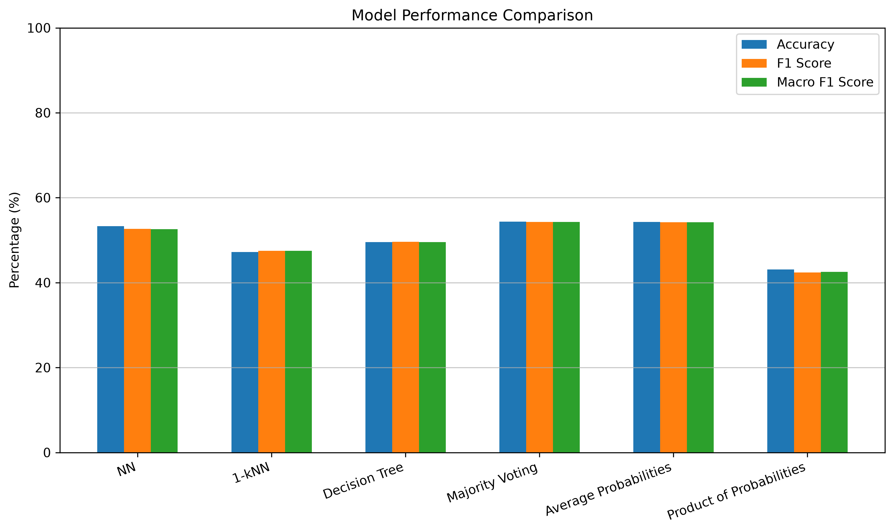
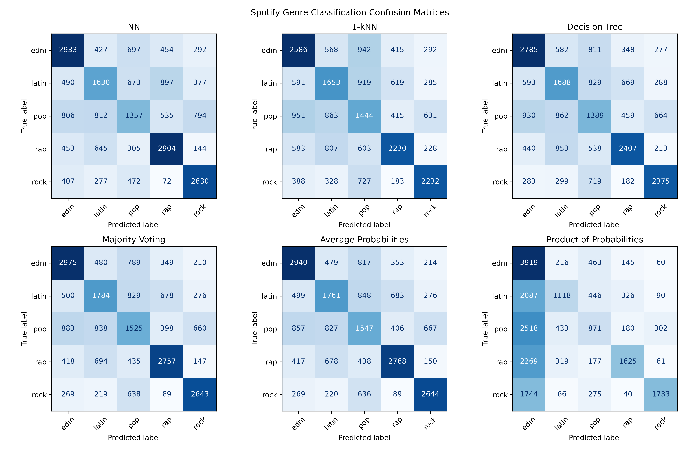

# Q1.1:  Baseline Classifiers and Voting Ensembles

## Goal

Evaluate 3 baseline classifiers (Decision Tree, Neural Network, and 1-nearest neighbour) for predicting Spotify playlist genres (`edm`, `latin`, `pop`, `rap`, `rock`), then compare three ensemble combination rules: Majority Voting, Average of Probabilities, and Product of Probabilities.

- **Implementation:** Python, using `scikit-learn`, `pandas`, `NumPy`, SciPy and Matplotlib.
- **Classifiers:** `DecisionTreeClassifier`, `MLPClassifier`, and `KNeighborsClassifier(n_neighbors=1)`.
- **Validation:** Stratified 10-fold cross-validation with fixed random seed 42 and identical splits for all models.
- **Preprocessing:** Numeric imputation and min-max scaling, and categorical imputation and one-hot encoding, fitted inside each training fold using scikit-learn pipelines.
- **Evaluation:** Overall Accuracy, Weighted F1 and Macro F1. Accuracy measures overall correct predictions; Weighted F1 accounts for genre frequency; Macro F1 gives each of the five genres equal importance.
- **Voting:** The three base classifiers are trained on the same folds. Majority Voting uses predicted classes (with average-probability tie-breaking in this Python implementation); Average Voting averages class probabilities; Product Voting multiplies them without smoothing.

These Python models are analogues of Weka's J48, MultilayerPerceptron, IBk and Vote.

## Results



*Figure 1. Performance comparison of three baseline classifiers and three voting ensembles. Scores are plotted as percentages.*

| Configuration | Accuracy (approx.) | Interpretation |
|---|---:|---|
| Neural Network | 53% | Strongest individual classifier |
| 1-NN | 47% | Weakest individual classifier |
| Decision Tree | 50% | Between 1-NN and the Neural Network |
| Majority Voting | 54% | Best or approximately tied for best overall |
| Average of Probabilities | 54% | Very similar to Majority Voting |
| Product of Probabilities | 43% | Substantially worse than the other ensembles |

*The percentages above are rounded from the supplied figure; consult `results/q1_1_results.csv` for exact metrics.*

## Confusion-matrix analysis



*Figure 2. Out-of-fold confusion matrices. Rows are actual playlist genres; columns are predicted genres. Diagonal entries represent correct classifications.*

The Neural Network performs best among the individual classifiers, while Majority Voting and Average of Probabilities produce very similar confusion matrices and modestly improve overall accuracy. The matrices show substantial overlap in predictions across genres, especially for `pop` and `latin`, indicating that the available audio features do not perfectly separate playlist categories. `edm`, `rap` and `rock` generally have stronger diagonal counts than `pop`.

Product of Probabilities behaves differently: it predicts `edm` disproportionately often, including many actual `latin`, `pop`, `rap` and `rock` tracks. This warrants checking how zero-probability products and ties are handled. In particular, 1-NN often returns a one-hot class-probability vector; multiplying it with zero probabilities from other classifiers can produce all-zero vectors. An unsmoothed `argmax` then defaults to the first encoded class. Therefore, the Product Voting result should **not** be interpreted as a clean comparison of ensemble quality until this diagnostic is completed.

## Discussion

The two strongest voting rules improve only slightly over the best individual classifier. This suggests that combining different learning algorithms can help, but the benefit is limited when their errors overlap.

## Reproduction

From the repository root, with dependencies installed and the personalised ARFF dataset in `data/`:

```bash
python q1_1.py
python visualise_q1_1.py
python q1_1_confusion_matrix.py
```
